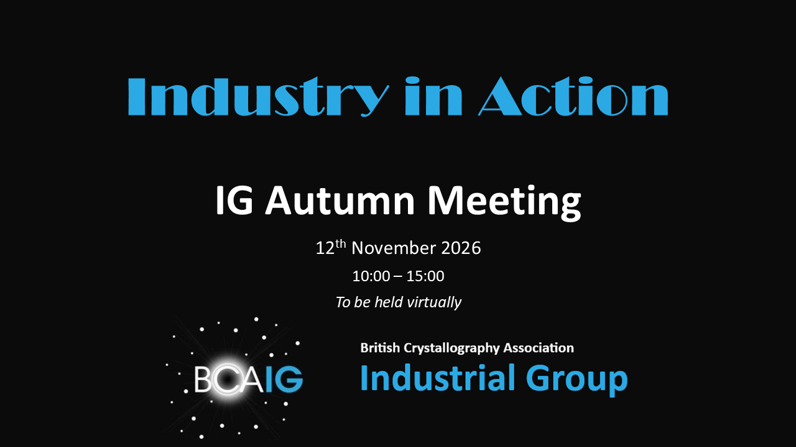

# Autumn Meeting 2026

The IG will be holding a virtual autumn meeting on the **12th November 2026** with the theme **Industry in Action**.

**Confirmed speakers:**

Dr. Luke Clifton (ISIS Neutron and Muon Source)

Dr. Clare Thorpe (University of Sheffield)

Dr. Edd Bilbe (Johnson Matthey)

Dr. Tony Bell (Sheffield Hallam University)

Dr. Max Terban (Momentum Transfer)

Dr. Tom Smith (Indicatrix Crystallography)

Dr. Rui Guo (Pfizer)

Zhuoran Yang (University of Liverpool)

Tickets are priced at £10 and can be purchased from Eventbrite, with the proceeds going towards bursaries to future crystallography meetings. [Purchase your tickets here](https://www.eventbrite.co.uk/e/bca-ig-autmun-meeting-industry-in-action-online-event-tickets-2003296851811)

Bursaries are available in cases of financial hardship. [Apply here](https://forms.gle/1FFRS4oqPCsutAcG9)

# **Agenda**

**Session 1: 10:00 – 11:50**

Chairs: _Dr. Luca Russo and Dr. Natalie Johnson_

| | |
| --- | --- |
| 10:00 - 10:10 | Opening Remarks (Dr. Luca Russo) |
| 10:10 - 10:40 | Dr. Luke Clifton (ISIS Neutron and Muon Source)   _Examining Membrane Biochemical Events with Neutron Reflectometry_ |
| 10:40 - 11:00 | Zhuoran Yang (University of Liverpool)   _AriadneX: Unknown crystalline phase discovery through Anomaly-aware unmixing of Power X-Ray Diffraction Patterns_ |
| 11:00 - 11:20 | Dr. Tony Bell (Sheffield Hallam University)   _An XRD and XRF study of the incorporation of SnO2 into soda lime silica glasses_|
| 11:20 - 11:50 | Dr. Edd Bilbe (Johnson Matthey)   _Consistency in a changing world_|

**Lunch break: 12:00 – 13:00**

**Session 2: 13:00 – 14:50**

Chairs: _Dr. Tony Bell and Dr. Natalie Johnson_

| | |
| --- | --- |
| 13:00 - 13:30 | Dr. Rui Guo  (Pfizer)|
| 13:30 - 13:50 | Dr. Tom Smith (Indicatrix Crystallography)   _An Enhanced Optical Microscope for High-Throughput Small-Molecule Crystallisation_|
| 13:50 - 14:10 | Dr. Max Terban (Momentum Transfer)   _Synchrotron powder diffraction for all: rapid access, high throughput, and dedicated support_|
| 14:10 - 14:40 | Dr. Clare Thorpe (University of Sheffield)   _What can shipwreck glasses tell us about nuclear waste degradation?_|
| 14:40 - 14:50 | Closing Remarks|

**IG AGM: 15:00 – 16:00**
